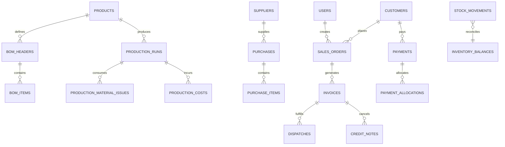

# FactoryFlow — Design Note

## 1. Entity Relationship Diagram

## 2. Stock Ledger Architecture

- **Source of Truth:** `stock_movements` is an append-only ledger. Every movement records `movement_type`, `qty_in` or `qty_out`, `running_balance`, `unit_cost`, `total_value`, `source_document_type`, `source_document_id`, and `created_by`.
- **Balance Cache:** `inventory_balances` stores the current on-hand quantity and weighted-average cost per item, updated atomically in the same `@Transactional` boundary.
- **Reconciliation:** `InventoryService.reconcileAll()` (exposed at `GET /api/inventory/reconcile`) sums `qty_in - qty_out` across `stock_movements` and verifies it equals `inventory_balances.current_quantity`.
- **Negative Stock Prevention:** Every deduction checks `available >= required` before writing to the ledger, throwing a `409 Conflict` and rolling back the entire transaction.

## 3. BOM & Pack-Size Reuse

- `bom_headers` stores versioned BOMs (`product_id`, `version`, `expected_output`, `batch_size`). Posted production runs retain the `bom_version` they used.
- **Pack-size reuse:** `products` has `base_product_id` and `bom_conversion_factor`. A new pack size (e.g. Murukku 500 g with factor `2.5`) reuses the 200 g base BOM without duplicating BOM rows.
- `UnitConverter` handles `BigDecimal` conversions (`kg↔g`, `L↔ml`, `pcs↔ctn`) and rejects incompatible dimensions (`kg` to `L`).

## 4. Variance Logic

- Material variance % = `((Actual Consumed − Planned) / Planned) × 100`
- Yield variance % = `((Actual Good Output − Expected Output) / Expected Output) × 100`
- **Strict-greater-than rule:** A line is flagged only when `|variance%| > tolerance` (default `3.0%`). Exactly `3.0%` (e.g. 194 pouches vs 200 planned = `-3.0%`) is **not** flagged.
- **Pouch handling:** Good pouches (`actualGoodOutput = 188`) are written as `PRODUCTION_ISSUE`, damaged pouches (`6`) as `DAMAGED_MATERIAL`, and total consumed (`194`) drives both variance and costing (`194 × ₹2.50 = ₹485`).

## 5. Inventory Valuation (Weighted Average vs FIFO)

- **Weighted Average Cost** is recomputed on each purchase receipt: `(currentQty × currentAvg + receiptQty × receiptRate) / (currentQty + receiptQty)`.
- Example: 100 kg flour @ ₹42 + 60 kg @ ₹45 = ₹6,900 / 160 kg = **₹43.125/kg**. Issuing 40 kg leaves 120 kg valued at **₹5,175.00**.
- **Comparison with FIFO:** Under FIFO, the 40 kg issue would be valued at the opening ₹42/kg rate (`₹1,680` instead of `₹1,725`), yielding a packet cost of `₹30.90` instead of `₹31.14`. Weighted average is chosen because bulk raw materials (flour, oil) are physically mixed in factory storage bins/tanks, making average cost both operationally accurate and simpler to audit.

## 6. Costing & Overhead Allocation Rule

- **Per-run overheads** (labour, gas, power entered on a run, even after posting) are charged 100% to that run: `Cost per good packet = Total Run Cost / Actual Good Output`.
- **Monthly overheads** (if allocated across runs) are allocated proportionally by good packets produced.
- **Assumed opening FG cost:** 50 opening packets of Murukku 200 g are valued at ₹30.00/packet.

## 7. GST & Rounding Logic

- Factory is in Tamil Nadu (state code `33`). Intra-state (`33`) → `CGST (2.5%) + SGST (2.5%)`. Inter-state (e.g. Karnataka `29`) → `IGST (5%)`.
- **Rounding:** Taxable amount and GST components are rounded per line item to 2 decimal places (`HALF_UP`), then summed for invoice totals.
- Posted invoices are never deleted; cancellations issue a `CreditNote` (`POST /api/invoices/{id}/credit-note`).
